# KnowHub · 医院知识中枢

> 掌典册之故，答众人之询，引原文为据。中文代号「掌故」。

[](https://github.com/xiaoshaguabuzai/KnowHub/actions/workflows/ci.yml)
[](https://github.com/xiaoshaguabuzai/KnowHub/actions/workflows/docker-publish.yml)
[](https://render.com/deploy?repo=https://github.com/xiaoshaguabuzai/KnowHub)

仓库：https://github.com/xiaoshaguabuzai/KnowHub

面向三甲医院的「制度知识库 + 可调教 RAG + 院内业务流程」Agent 可运行 MVP：
内置 36 篇知识内容：28 篇分领域院内制度（医疗 / 药事 / 护理 / 院感 / 医技 / 公卫 / 信息）+ 8 篇患者就医指南，
Ktor AI 中台 + Compose Multiplatform 客户端（Android / Desktop / Web 同一套 UI），支持**中台 / 直连（API Key）双接入**。

应用图标：

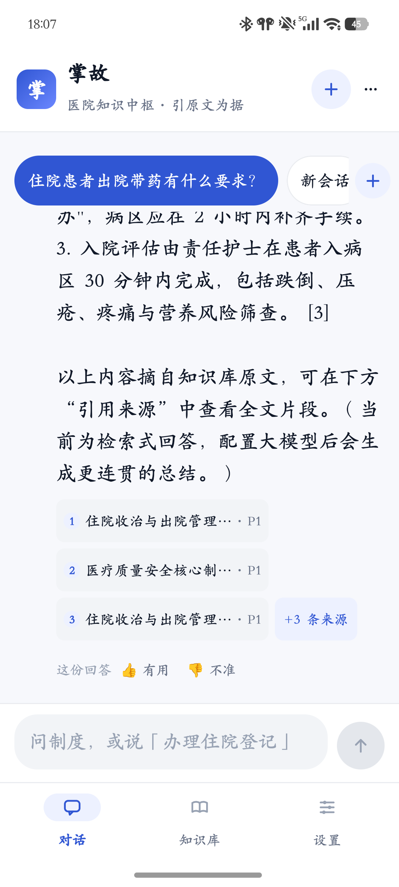

## 1. 当前实现状态

| 能力 | 状态 | 说明 |
| --- | --- | --- |
| 账号登录 / 角色鉴权 | ✅ | PBKDF2 密码哈希 + HMAC 无状态令牌；医务处（admin）/ 职工（member）/ 人事科（hr） |
| 登录体验 | ✅ | 密码明文切换、账号/密码规则校验、服务端可达性探测、一键院内演示身份、键盘 Next/Done 流转 |
| 制度入库 | ✅ | 文本 / Markdown / CSV / JSON / **PDF**（PDFBox 按页解析），异步解析→切块→索引；制度带文号 / 归口 / 生效日期 |
| 制度查看 | ✅ | 内置阅读器：标题 / 条款 / 页码排版，正文可选中复制；顶部展示文号、归口、生效日期；查看接口同样受 ACL 约束 |
| 混合检索 | ✅ | 36 篇内容、125 个片段（职工可见 33 篇 / 114 片段，患者 8 篇）；BM25 稀疏 + 哈希向量稠密（0.55/0.45 融合），片段级溯源（制度 / 页码 / 章节） |
| 文档级 ACL | ✅ | **检索阶段强制过滤**（非 UI 隐藏）；薪酬保密办法仅人事科，纠纷/重大过失两份仅医务处 |
| 患者视角 | ✅ | 独立 `patient` 角色：仅见 8 篇就医指南与门诊预约流程，内部制度的检索与查看均 403，回答自动附就医提示 |
| 双接入模式 | ✅ | 中台（Ktor：知识库 / 流程 / 附件 / 患者职工权限）与直连（API Key + 本地知识库/流程/附件）能力对齐，一键切换，直连无需部署服务端 |
| SSE 流式问答 | ✅ | `POST /api/v1/chat/stream`，事件含 `id/seq/sessionId/messageId/traceId`，可断线续接 |
| 输入快捷键 | ✅ | Enter 发送、Shift+Enter 换行，输入法「发送」键同样生效 |
| 语音输入 | ✅ | 调系统语音识别转文字（无识别服务的设备会明确提示） |
| 文件 / 拍照 | ✅ | 文件（PDF/文本）服务端解析正文；拍照在端侧 ML Kit OCR 后填入输入框，图片同时作为附件留档 |
| 大模型接入 | ✅ 可切换 | 未配置时走**检索式回答**（可离线演示）；配置 OpenAI 兼容接口后流式生成 |
| 流程编排 | ✅ | 住院登记 / 危急值上报 / 设备报修，状态机引擎：收参 / 调工具 / 分支 / 回执，可断点续跑 |
| 工具调用 | ✅ | 白名单注册表 + 参数校验 + 审计（住院处、检验科、设备科三个院内工具） |
| 调教闭环 | ✅ | 回答引用处 👍/👎 → 反馈样本 → 对后续召回加减权（+0.25 / −0.35） |
| 审计 / 统计 | ✅ | 登录、导入、删除、配置、工具、问答、反馈留痕；运营大盘（制度/片段/未命中/时延/反馈） |
| 检索配置 | ✅ | 管理员可改 TopK / 切片 / 重叠 / 最低分 / 强制溯源 / 调教开关，立即生效并支持重建索引 |
| HIS / EMR 对接 | ⏳ 未实现 | 当前工具为演示实现，生产需对接院内集成平台与实名主数据 |
| 小程序 / iOS 离线 / 端侧 LLM | ⏳ 未实现 | 架构与契约已预留（见技术方案第 6、7 章） |

## 2. 知识库内容（三甲制度 + 患者就医指南，36 篇）

制度带**文号、归口科室、生效日期**，列表可按归口筛选，阅读器顶部展示元信息。

| 领域 | 制度（文号 · 归口） |
| --- | --- |
| 门急诊 | 门诊首诊负责与转诊制度（YW-ZD-001 · 医务处）、急诊预检分诊与绿色通道制度（YW-ZD-002 · 急诊科） |
| 住院与核心制度 | 住院收治与出院管理规范（YW-ZD-003）、医疗质量安全核心制度要点（YW-ZD-004）、会诊与 MDT 管理制度（YW-ZD-005）、手术分级与围手术期管理制度（YW-ZD-006）、危急值报告与处置制度（YW-ZD-007） |
| 质量与安全 | 电子病历书写与管理规范（YW-ZD-009 · 病案科）、医疗技术临床应用与新技术准入制度（YW-ZD-010）、医疗不良事件上报与根因分析制度（YW-ZD-011 · 质控办）、临床用血管理制度（YW-ZD-008 · 输血科） |
| 药事 | 抗菌药物分级使用管理规定（YW-YL-001）、麻醉药品与第一类精神药品管理制度（YW-YL-002）、处方点评与合理用药管理制度（YW-YL-003）、高警示药品管理制度（YW-YL-004，均归口药学部） |
| 护理 | 护理分级与交接班制度（YW-HL-001）、护理不良事件与跌倒压疮管理（YW-HL-002）、静脉输液与给药安全制度（YW-HL-003，均归口护理部） |
| 院感 | 医院感染防控与手卫生规范（YW-GK-001）、多重耐药菌与导管相关感染防控（YW-GK-002）、消毒隔离与环境卫生学监测（YW-GK-003，均归口院感科） |
| 医技 / 公卫 / 信息 | 检验标本采集与报告时限管理（YW-JY-001 · 检验科）、医学影像检查与报告制度（YW-JY-002 · 影像科）、传染病疫情报告与发热门诊管理（YW-GW-001 · 公共卫生科）、医院信息与患者隐私保护制度（YW-XX-001 · 信息中心） |
| 受限制度 | 职工薪酬与绩效保密办法（RS-BM-001 · 人事科，仅 hr）、医疗纠纷内部处理指引（YW-JF-001 · 医务处，仅 admin）、重大医疗过失与医疗事故内部上报流程（YW-JF-002 · 医务处，仅 admin） |
| 患者指南 | 门诊预约与挂号、住院办理与陪护探视、检验检查注意事项、医保报销与费用结算、出院随访与复诊、患者投诉与满意度、发热门诊就诊、检查报告查询与线上服务（8 篇，audience=all，患者与职工都可见） |

可见范围：`patient` 8 篇就医指南、`demo` 33 篇、`hr` 34 篇、`admin` 36 篇；检索与查看均在服务端按角色 + audience 过滤。

院内流程（对话中直接触发）：

- **住院登记协助**：患者姓名 → 住院证号 → 收治科室 → 生成 `ADM-` 登记号，待床位分配。
- **检验危急值上报**：住院号 → 检验项目 → 危急值 → 生成 `CV-` 上报记录，通知主管医师/检验科。
- **医疗设备报修**：设备编号 → 故障现象 → 生成 `RP-` 工单，设备科 2 小时内响应。
- **门诊预约（患者可用）**：姓名 → 科室 → 日期 → 手机号 → 生成 `APT-` 预约号与取号提示。

## 3. 架构

```
Android / Desktop / Web (Compose Multiplatform, app:shared)
        │  Ktor Client（OkHttp / Darwin / Js）
        │  POST /api/v1/chat/stream  (SSE)
        ▼
Ktor AI 中台 (server)
  ├─ AuthService        登录、HMAC 令牌、RBAC
  ├─ IngestService      PDFBox/文本解析 → Chunker → 索引
  ├─ DocumentStorage    制度原文按页落盘（阅读器直接读原文）
  ├─ IndexService       制度库版本变化时重建 HybridRetriever
  ├─ ChatService        意图识别 → RAG / 流程 / 闲聊 / 调教
  ├─ FlowRunner(共核)   状态机：collect_param / tool_invoke / branch / message
  ├─ AttachmentService  会话附件：PDF/文本解析、图片登记\n  ├─ ToolRegistry       住院登记、危急值上报、设备报修
  └─ AuditService       操作审计
        │  JSON 快照 + 制度原文落盘（data/）
        ▼
core（commonMain，全部平台共用）
  models / 契约 DTO / 分词 / 切块 / BM25+向量检索 / ACL / 流程引擎 / SSE 编解码
```

关键设计：

- **契约单一来源**：请求/响应、SSE 事件、路由常量都定义在 `core`，服务端与客户端不各写一份。
- **检索期 ACL**：`HybridRetriever` 在打分前用 `Acl.canRead` 过滤，越权制度不会进入上下文。
- **可降级**：没有大模型时用抽取式回答；大模型失败自动回退；流程暂停状态持久化在会话上。
- **确定性**：分词、哈希向量、BM25 全部纯 Kotlin，跨端行为一致，方便单测。

## 4. 两种接入方式

| 模式 | 入口 | 能力 | 依赖 |
| --- | --- | --- | --- |
| 中台模式 | 登录页「中台模式」；设置里切换 | 院内知识库、流程、附件解析、患者/职工权限 | Ktor 服务（默认 `:8080`） |
| 直连模式 | 登录页「直连模式」；设置里切换 | 与中台对齐：本地知识库（36 篇）、流程、附件解析、引用、调教、语音；可自选模型 | 手机/桌面可直接访问的 OpenAI 兼容接口 |

直连模式填写 **API Key + 接口地址 + 模型名** 即可开始（默认 `https://api.openai.com/v1`、`gpt-4o-mini`）；
本地内置 36 篇知识快照、4 条流程、检索/ACL/附件解析与调教样本，患者/职工/医务处/人事科身份可切换。
API Key 仅保存在本次运行内存；会话与附件也在内存中，重启清空；管理端导入/统计仍以中台为准。

## 5. 快速开始

环境要求：JDK 21、Android SDK（编译 Android 时）、Gradle Wrapper 自带。以下命令以 Windows 为例；macOS/Linux 把 `.\gradlew.bat` 换成 `./gradlew`。

```bash
# 1) 启动 AI 中台（默认 0.0.0.0:8080，数据落在 ./data）
.\gradlew.bat :server:run

# 2) 健康检查
curl http://127.0.0.1:8080/healthz
# {"status":"ok","version":"1.0.0","llm":"retrieval","documents":36,"chunks":125,...}
```

### Android 真机

```bash
adb reverse tcp:8080 tcp:8080        # 让手机上的 127.0.0.1:8080 指向电脑
.\gradlew.bat :app:androidApp:assembleDebug
adb install -r app/androidApp/build/outputs/apk/debug/androidApp-debug.apk
adb shell am start -n com.example.knowhub/.MainActivity
```

首次安装若提示 `INSTALL_FAILED_USER_RESTRICTED`：解锁屏幕后重试（小米等机型需在开发者选项开启「USB 安装」）。
App 内默认服务端地址 `http://127.0.0.1:8080`，可在登录页或「设置」中改为局域网地址。

### 桌面 / Web

```bash
.\gradlew.bat :app:desktopApp:run
.\gradlew.bat :app:webApp:wasmJsBrowserDevelopmentRun
```

### 部署中台到 GitHub + 云端

GitHub 本身不运行常驻服务（Pages 只能托管静态页，Actions 只跑定时任务），因此中台采用：
**GitHub 托管代码 + CI + 容器镜像 → Render / Railway / Fly 等容器平台运行**。仓库已内置：

| 文件 | 作用 |
| --- | --- |
| `Dockerfile` | 多阶段构建，产物来自 `:server:installDist`；非 root 运行，数据卷 `/data` |
| `.dockerignore` | 排除构建产物、`data/`、文档与截图，缩小上下文 |
| `.github/workflows/ci.yml` | push / PR 跑 core、server、直连模式测试 |
| `.github/workflows/docker-publish.yml` | main 构建并推送 `ghcr.io/<owner>/<repo>`（latest / 分支 / sha） |
| `render.yaml` | Render Blueprint：Docker、免费实例、`/healthz`、自动生成 `KNOWHUB_TOKEN_SECRET` |

**1）推到 GitHub**

```bash
git init
git add .
git commit -m "KnowHub hospital knowledge platform"
git branch -M main
git remote add origin https://github.com/<you>/<repo>.git
git push -u origin main
```

**2）部署到 Render（推荐，免费）**

- Render 控制台 → **New → Blueprint** → 选择该仓库 → Apply。
- 在 Environment 填可选变量：`KNOWHUB_LLM_BASE_URL`、`KNOWHUB_LLM_API_KEY`、`KNOWHUB_LLM_MODEL`（不填则检索式回答）。
- 部署完成后拿到 `https://<service>.onrender.com`，在 App 登录页「服务端地址」填入，即可跨公网使用。

**3）或直接运行 GHCR 镜像**

```bash
docker run -p 8080:8080 \
  -v knowhub-data:/data \
  -e KNOWHUB_TOKEN_SECRET=change-me \
  -e KNOWHUB_LLM_BASE_URL=https://api.deepseek.com/v1 \
  -e KNOWHUB_LLM_API_KEY=sk-... \
  ghcr.io/<owner>/<repo>:latest
```

**环境变量**

| 变量 | 默认 | 说明 |
| --- | --- | --- |
| `KNOWHUB_PORT` / `PORT` / `KNOWHUB_HOST` | `8080` / `0.0.0.0` | 监听端口；云平台注入 `PORT` 时自动适配 |
| `KNOWHUB_DATA_DIR` | `data` | JSON 快照与原文目录，容器内建议 `/data` |
| `KNOWHUB_TOKEN_SECRET` | 自动生成 | 登录令牌签名密钥；未设置时重启后令牌失效 |
| `KNOWHUB_LLM_BASE_URL` / `_API_KEY` / `_MODEL` | 空 / 空 / `deepseek-chat` | OpenAI 兼容大模型；不配则走检索式回答 |

**注意事项**

- Render 免费实例会休眠，冷启动约 30 秒；`render.yaml` 用 `/tmp` 存数据，重启会重置并重新 seed（演示可接受）。
- 生产请挂持久磁盘（Render Starter 的 Disk）或替换为 PostgreSQL；`TokenSecret` 必须固定，否则用户需反复登录。
- GitHub Actions 构建镜像约 5–8 分钟；Render 也可直接用仓库 Dockerfile 构建，不依赖 GHCR。
- 临时演示：GitHub Codespaces 打开仓库后运行 `./gradlew :server:run`，把 8080 端口设为 Public，即可得到临时公网地址。
- 服务端 CORS 当前为 `anyHost()`，Web 端可跨域；生产建议收窄到固定域名。
- 密钥只放在平台环境变量，不要提交 `.env` 或真实 API Key。
**Render 打不开 / 超时？** 这是网络不可达（`render.com` 在部分网络被限制），不是仓库配置问题。按场景选：

#### A. 同一 WiFi 直连（最快，无需公网）

1. 电脑启动 `.\gradlew.bat :server:run`（已监听 `0.0.0.0:8080`）。
2. `ipconfig` 查 IPv4，例如 `192.168.0.101`。
3. 手机与电脑连同一 WiFi，App 登录页「服务端地址」填 `http://192.168.0.101:8080`。
4. 若手机打不开，用**管理员** PowerShell 放行端口（或临时关闭专用网络防火墙）：

```powershell
New-NetFirewallRule -DisplayName "KnowHub 8080" -Direction Inbound -Protocol TCP -LocalPort 8080 -Action Allow -Profile Private
```

#### B. GitHub Codespaces（公网、无需新账号）

仓库已包含 `.devcontainer/devcontainer.json`（Java 21、8080 端口公开）：

1. 仓库页 **Code → Codespaces → Create codespace on main**。
2. 终端运行 `./gradlew :server:run`（首次下载依赖约 2–4 分钟）。
3. 底部 **Ports** → `8080` → 右键 **Visibility → Public**。
4. 复制 `https://<codespace>-8080.app.github.dev`，填入 App 服务端地址。

免费额度约 60 核时/月；Codespace 停止后地址失效，适合演示，不适合长期。

#### C. 国内云主机（长期）

阿里云 / 腾讯云轻量 2C2G，安装 JDK 21 或 Docker 后：

```bash
git clone https://github.com/xiaoshaguabuzai/KnowHub.git
cd KnowHub
./gradlew :server:installDist
KNOWHUB_DATA_DIR=/var/lib/knowhub KNOWHUB_TOKEN_SECRET=change-me \
  server/build/install/server/bin/server
```

安全组放行 8080，建议 Nginx + HTTPS；GHCR 在国内可能拉不动，直接在主机上构建更稳。

#### D. 其他容器平台

Railway / Fly.io / Koyeb / Zeabur 都可直接用本仓库的 `Dockerfile`；Render 能访问时一键链接依然可用。

## 6. 演示账号与脚本

| 账号 | 密码 | 身份 | 可见范围 |
| --- | --- | --- | --- |
| `demo` | `demo1234` | 张医生（内科） | 33 篇（25 制度 + 8 指南） |
| `hr` | `hr1234` | 人事科 | 34 篇（含薪酬保密办法） |
| `admin` | `admin1234` | 医务处管理员 | 全部 36 篇 + 导入 / 调参 / 统计 |
| `patient` | `patient1234` | 王女士（患者） | 8 篇就医指南 + 门诊预约 |

登录页支持一键切换「医师 / 医务处 / 人事科」三个演示身份，不必手动输入。

推荐的 3 分钟演示：

1. **登录体验**：清空账号点登录 → 红框提示「请输入账号或工号」；密码输入纯字母 → 提示「密码需同时包含字母与数字」；点右侧眼睛可查看明文。
2. **问制度**：问「住院患者出院带药有什么要求？」→ 命中《住院收治与出院管理规范》，点「+N 条来源」看完整条款与匹配度，可 👍/👎。
3. **看原文**：进「知识库」点任意制度 → 阅读器按标题/条款排版，长按可复制。
4. **走流程**：说「我要办理住院登记」→ 依次提供患者姓名、住院证号、科室（Enter 直接发送）→ 生成 `ADM-` 登记号。
5. **ACL 演示**：用 `demo` 问「职工薪酬保密有哪些要求？」→ 未命中；换「人事科」身份再问 → 命中受限制度。

## 7. API 一览

统一前缀 `/api/v1`，除登录/健康检查外均需 `Authorization: Bearer <token>`。

| 方法 | 路径 | 权限 | 说明 |
| --- | --- | --- | --- |
| GET | `/healthz` | 公开 | 健康检查（含制度/片段数、推理模式） |
| POST | `/auth/login` | 公开 | 登录，返回令牌与用户 |
| GET | `/auth/me` | 登录 | 当前用户 |
| GET/POST | `/sessions` | 登录 | 会话列表 / 新建 |
| GET | `/sessions/{id}/messages` | 本人 | 历史消息（含引用） |
| DELETE | `/sessions/{id}` | 本人 | 删除会话 |
| POST | `/chat/stream` | 登录 | **SSE 流式问答**（制度 / 流程 / 闲聊 / 调教；可带 `attachmentIds`） |
| POST | `/attachments` | 登录 | 上传会话附件（≤10MB），PDF/文本抽取正文，返回 `attachmentId` |
| GET | `/documents` | 登录 | 可见制度列表（ACL 过滤） |
| GET | `/documents/{id}` | 登录 | **查看制度原文**（阅读器；无权返回 403） |
| POST | `/documents` | admin | multipart 上传（PDF/TXT/MD/CSV/JSON） |
| POST | `/documents/text` | admin | 文本建库（含 `aclRoles`） |
| DELETE | `/documents/{id}` | admin | 删除制度与片段 |
| POST | `/documents/{id}/reindex` | admin | 重建索引 |
| GET/POST/PUT/DELETE | `/flows[/{id}]` | 读：登录；写：admin | 流程模板 CRUD（写入前 `FlowValidator` 校验） |
| GET | `/tools` | 登录 | 院内工具清单 |
| POST | `/tools/{id}/invoke` | 登录 | 调用白名单工具（审计） |
| GET/PUT | `/config/rag` | admin | 检索配置 |
| GET | `/stats/overview` | admin | 运营统计 |
| GET | `/audit` | admin | 审计日志 |
| POST | `/feedback` | 登录 | 👍/👎，生成调教样本 |

SSE 事件（`event:` 与 JSON 内 `type` 一致）：`meta` / `text` / `source` / `flow_step` / `done` / `error`，
每帧带 `id`（序号），`data:` 为完整事件 JSON。

```text
id: 7
event: text
data: {"type":"text","seq":7,"sessionId":"ses_x","messageId":"msg_y","traceId":"tr_z","content":"危急值应在"}
```

## 8. 流程编排模型

`FlowTemplate` 由强类型节点组成（不再是任意 object）：

```json
{
  "flowId": "flow_admission",
  "name": "住院登记协助",
  "triggerKeywords": ["住院登记", "办理住院", "收治入院"],
  "startNodeId": "n1",
  "nodes": [
    {"nodeId": "n1", "nodeType": "collect_param",
     "config": {"prompt": "请提供患者姓名", "variable": "patientName"},
     "nextNodeId": "n2"},
    {"nodeId": "n2", "nodeType": "tool_invoke",
     "config": {"toolId": "create_admission_request",
                "args": {"patientName": "${patientName}", "admissionNo": "${admissionNo}", "dept": "${dept}"},
                "resultVariable": "admission"},
     "nextNodeId": "n3"},
    {"nodeId": "n3", "nodeType": "message", "config": {"text": "${admission}"}}
  ]
}
```

节点类型：`collect_param` / `tool_invoke` / `branch` / `source_ref` / `message`。
校验器检查：节点类型、必填配置、悬空引用、环、不可达节点；执行引擎限制最大步数并持久化暂停状态。

## 9. 检索与调教

- 切块：按空行/标题分块 → 句子聚合到 `chunkSizeTokens`，块间重叠，保留页码与章节，剔除 Markdown 标记。
- 召回：`score = 0.55 × BM25归一化 + 0.45 × 哈希向量余弦`；`minScore` 过滤；按 ACL 前置过滤。
- 调教：对同一片段的正/负反馈样本按查询相似度（Jaccard ≥ 0.45）加减权，实时影响排序。
- 溯源：每个片段带 `docId / docName / page / section / snippet / score`，首条引用展示完整条款。

## 10. 配置

| 环境变量 | 默认值 | 说明 |
| --- | --- | --- |
| `KNOWHUB_PORT` | `8080` | 监听端口 |
| `KNOWHUB_HOST` | `0.0.0.0` | 监听地址 |
| `KNOWHUB_DATA_DIR` | `data` | 数据目录（JSON 快照、制度原文、令牌密钥） |
| `KNOWHUB_LLM_BASE_URL` | 空 | OpenAI 兼容地址，如 `https://api.deepseek.com/v1` |
| `KNOWHUB_LLM_API_KEY` | 空 | 大模型 Key |
| `KNOWHUB_LLM_MODEL` | `deepseek-chat` | 模型名 |
| `KNOWHUB_MAX_UPLOAD_MB` | `20` | 上传大小限制 |

配置了 `KNOWHUB_LLM_BASE_URL` 后自动切换为流式大模型回答；未配置或调用失败时回退为检索式回答。

## 11. 测试

```bash
.\gradlew.bat :core:jvmTest          # 14 项：分词/切块/BM25/ACL/患者可见性/调教/流程引擎/SSE/意图
.\gradlew.bat :server:test           # 10 项：登录/权限/SSE/ACL 双向/患者视角/流程/导入索引/查看/附件/反馈
.\gradlew.bat :app:shared:jvmTest     # 8 项：直连 SSE / 本地检索 / 流程 / 附件 / PDF 解析
powershell -File scripts/smoke-test.ps1   # 41 项真实 HTTP + SSE 端到端校验
```

`scripts/smoke-test.ps1` 覆盖：鉴权失败、RBAC、SSE 事件完整性、ACL 正反例、患者只读指南与预约、制度正文与越权 403、附件上传与引用、住院登记四步、导入→索引→检索、统计权限、反馈落库。

## 12. 已知限制与下一步

1. **院内系统对接**：工具为演示实现，生产需对接 HIS/EMR/LIS、住院处与设备科工单系统，并接入院内统一身份（OIDC/企业微信/钉钉）。
2. **存储**：JSON 快照适合 MVP，生产需 PostgreSQL（元数据/审计）+ Milvus（向量）+ MinIO（原文），接口已隔离。
3. **检索**：稠密向量为哈希特征，非语义模型；接入 BGE / 院内 Embedding 服务后质量会显著提升（`Embedder` 接口已预留）。
4. **文档解析**：扫描件 PDF 暂无 OCR（PaddleOCR 待接入），复杂表格版式还原有限。
5. **合规**：演示数据为脱敏样例；生产需按等保与医疗数据分级要求补齐传输加密、审计 WORM、访问留痕与权限复核。
6. **UI / 端侧能力**：语音识别依赖设备系统识别服务（部分设备未内置会提示）；图片 OCR 在端侧完成，服务端不做图片识别；附件上限 10MB；APK 因内置中文 OCR 模型约 80MB。
7. **直连模式**：本地知识库是内置快照（不随中台导入实时更新）；会话与附件仅保存在内存；PDF 文本抽取在端侧完成；模型仅支持 OpenAI 兼容的 `/chat/completions` SSE。
8. **其他**：管理后台尚未独立（Vue），小程序 / iOS 离线 / 端侧 LLM 未实现；中文字体在部分机型会回退为衬线体。

## 13. 文档索引

| 文档 | 说明 |
| --- | --- |
| [掌故 KnowHub 技术方案文档（纯 Markdown 还原版）](掌故%20KnowHub%20技术方案文档（纯%20Markdown%20还原版）.md) | 原始方案（已从 HTML 快照还原，需人工校对） |
| [技术验证报告](掌故%20KnowHub%20技术方案文档-技术验证报告.md) | 对方案的全局技术验证：9 项 P0、30+ 项 P1、选型复核、整改与复审 Gate |

## 14. 界面与交互

参考 Perplexity / Notion AI / Linear 的信息密度与留白：自定义线性图标、卡片不堆阴影、正文优先、引用随手可查。

| 登录（含服务探测） | 登录校验与明文切换 |
| --- | --- |
| 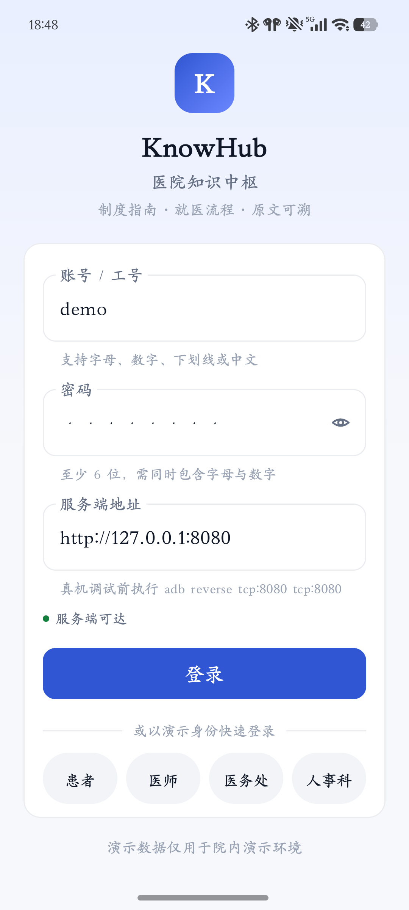 | 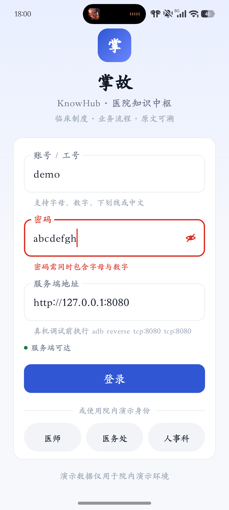 |

| 中台登录（患者 / 职工） | 直连模式（API Key） |
| --- | --- |
|  | 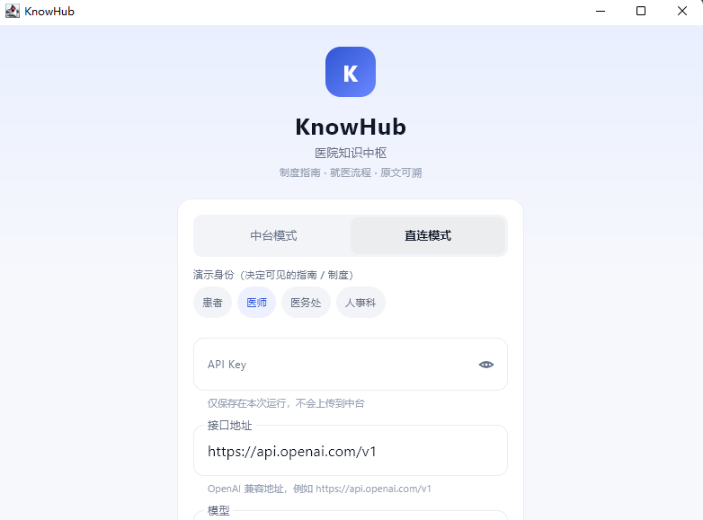 |

| 空态与能力入口 | 知识与引用 |
| --- | --- |
| 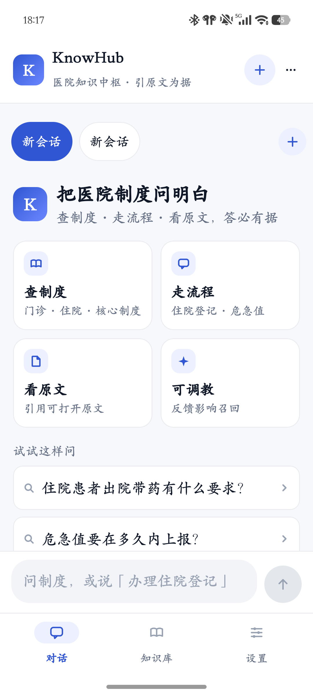 |  |

| 制度列表（职工 33 篇） | 按归口筛选（医务处 7 篇） |
| --- | --- |
| 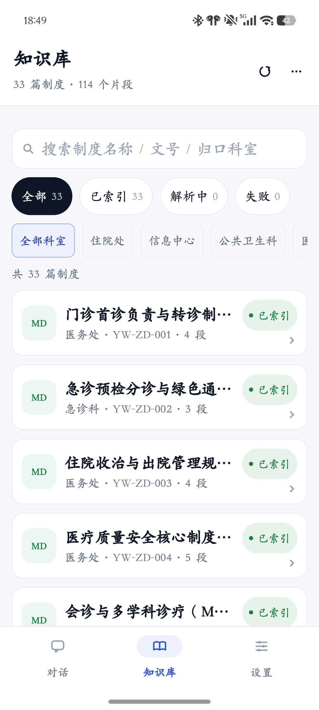 | 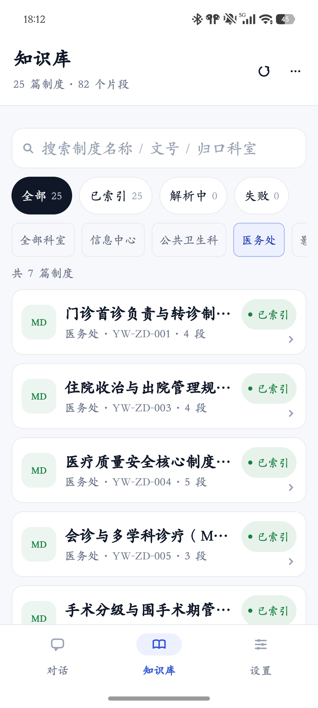 |

| 患者首页（就医指南） | 患者问答（引用指南） |
| --- | --- |
| 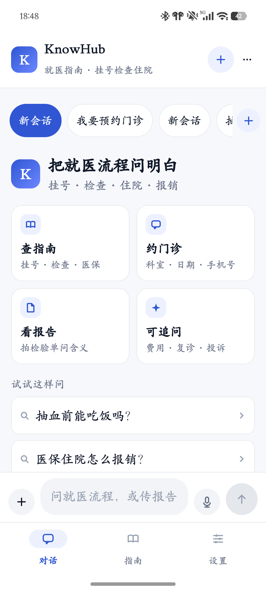 | 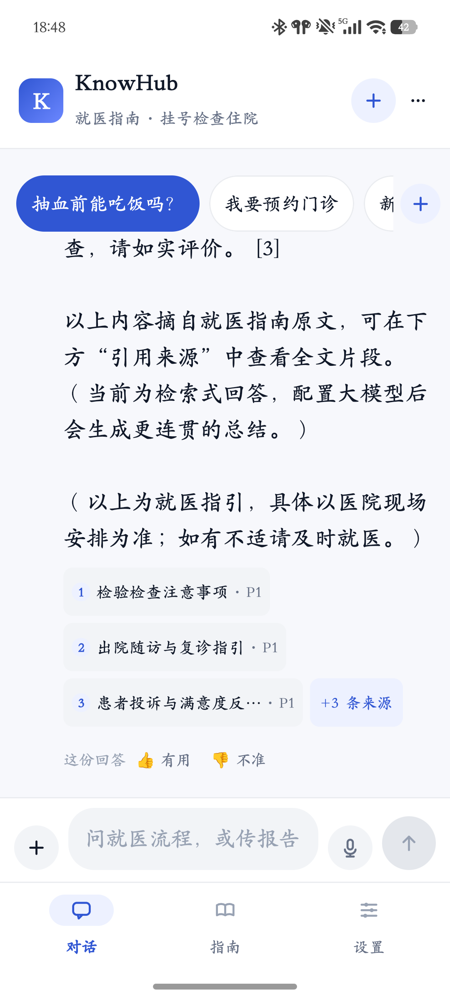 |

| 就医指南（8 篇） | 门诊预约流程（APT-） |
| --- | --- |
| 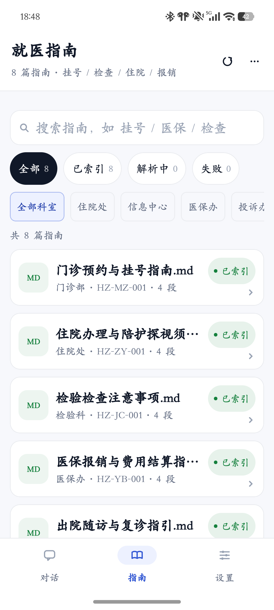 | 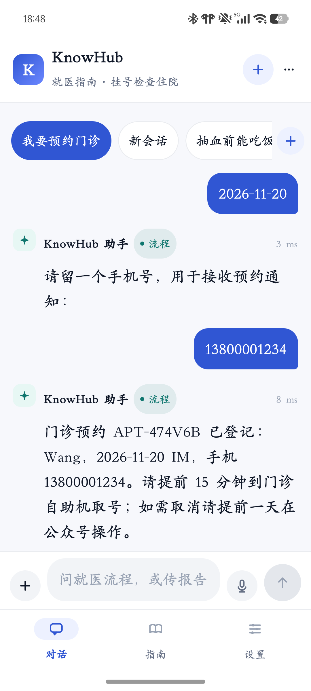 |

| 制度阅读器（文号 / 归口 / 生效日期） |
| --- |
| 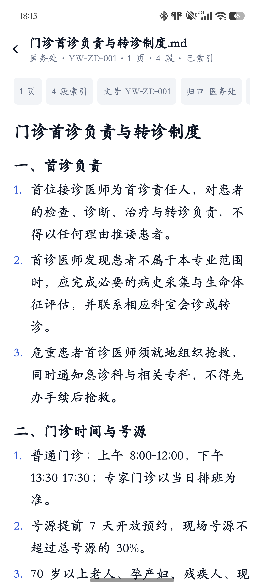 |

| 引用来源面板 | 附件已解析 |
| --- | --- |
| 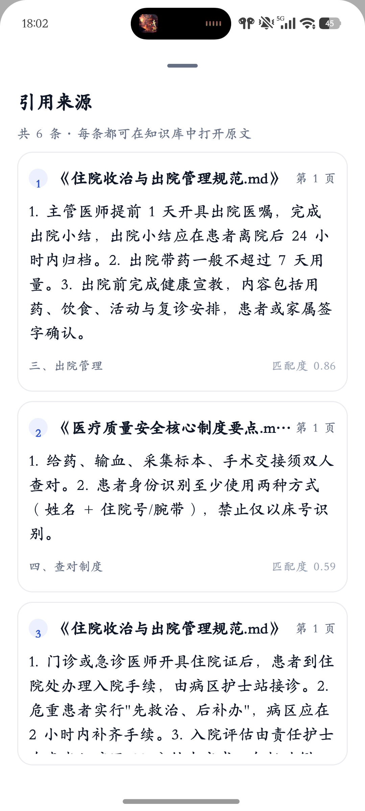 | 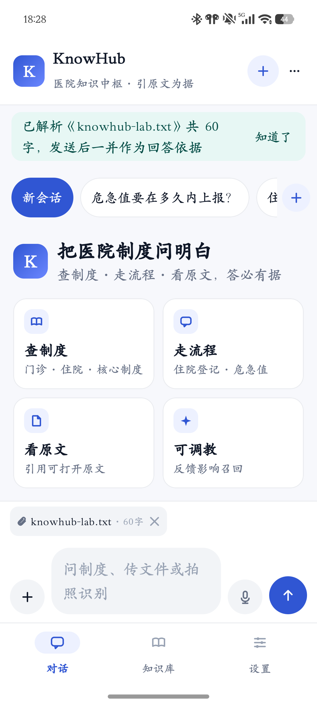 |

| 输入增强（拍照 / 文件 / 语音） | 拍照 OCR 填入输入框 |
| --- | --- |
| 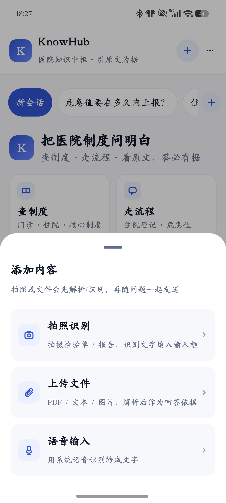 | 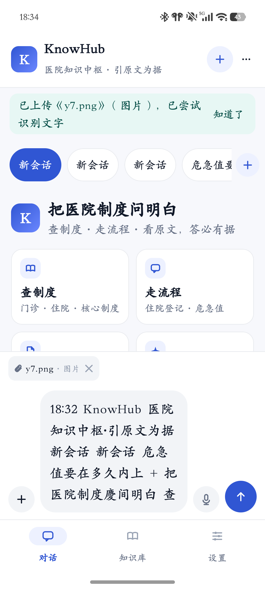 |

交互约定：

- **登录**：账号 2-32 位（字母/数字/下划线/中文）；密码至少 6 位且同时包含字母与数字；右侧眼睛切换明文；服务端不可达时红点提示并可重试。
- **发送**：Enter 发送；Shift+Enter 换行；移动端输入法「发送」键同样发送。
- **输入增强**：左下「＋」打开拍照识别 / 上传文件 / 语音输入；附件在发送前可移除，发送后作为回答依据并出现在引用来源中。
- **引用**：回答下方编号 chip 点击直接打开来源面板；「+N 条来源」查看全部；面板内可继续 👍/👎。
- **制度**：列表点击任意制度进入阅读器，长按可选择复制；管理员可在阅读器右上角重建索引或删除。
- **搜索与筛选**：制度库支持按名称 / 文号 / 归口科室搜索，按状态（全部/已索引/解析中/失败）与归口科室双重筛选。
